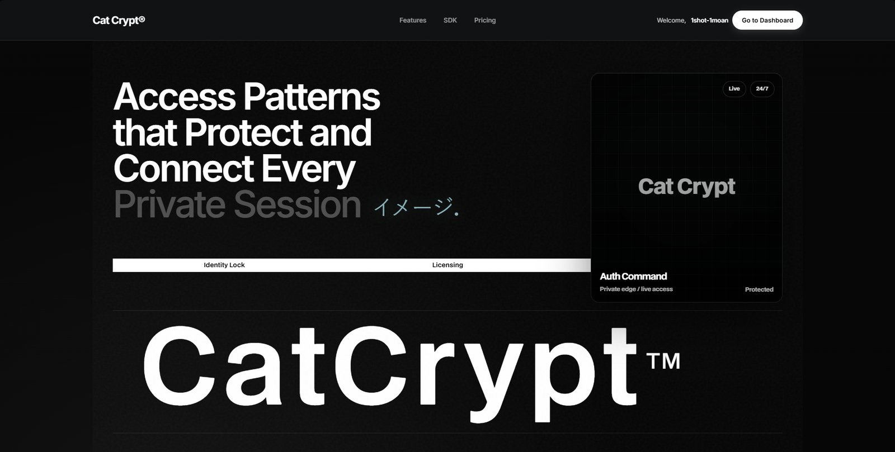

# CatCrypt

Licensing and authentication backend for software products — HWID machine binding, license keys, a live operator dashboard, and SDKs for the apps that integrate with it.

**Live at:** https://auth.script-kittens.com
**Discord:** https://discord.gg/wYZeuJQNCy



## What it does

CatCrypt protects your software with account-based licensing. Your users log in, their machine gets bound by HWID, and every session, key, and file download is checked against your rules — all from one dashboard.

## Features

- **Applications** — create and manage products, versions, pause/resume with instant lockdown, Discord webhook notifications.
- **Users** — username/password accounts with plans, expiry, HWID binding, HWID reset, ban/unban, API keys, and per-user session limits.
- **License keys** — generate, track, redeem, and delete keys (free / starter / pro / lifetime).
- **Live sessions** — real-time view of active logins with instant revocation.
- **Variables** — push runtime configuration to integrated apps from the dashboard.
- **Runtime Vault (file hosting)** — serve protected files to authenticated, entitled users only (Starter plan and up).
- **Blacklist** — block HWIDs, IPs, or usernames, per app or platform-wide.
- **Teams** — invite admins and viewers by email; owners, admins, and viewers have distinct permissions.
- **Event logs** — full audit trail of logins, bans, redemptions, and changes.
- **Real-time dashboard** — server-sent events (SSE) keep stats, sessions, and logs live without refreshes.
- **Cat Agent** — an AI chat panel in the dashboard that answers questions from live workspace data and can execute operator actions through a 19-tool agent (users, keys, sessions, variables, blacklist, events, app status). Destructive actions require explicit confirmation.
- **Security telemetry** — clients can report security flags; the platform tracks and alerts on them.
- **Mobile-ready** — the landing page and dashboard are fully responsive, built for phones as well as desktop.

## Pricing

| Plan | Price | What's included |
| --- | --- | --- |
| Free | $0 | Core licensing, 1 app, community support |
| Starter | $1 | More apps, Runtime Vault file hosting |
| Pro | $2 | Everything — all features included |

## SDKs

Integrate CatCrypt into your app in minutes. SDKs are available for Python, C#, and C++ — all with full feature parity (login, register, redeem, validate, variables, file download, HWID lock, `is_paid` check).

| Language | Repository |
| --- | --- |
| Python | [CatCrypt-Python-Example](https://github.com/ScriptKittenss/CatCrypt-Python-Example) |
| C# | [CatCrypt-CSharp-Example](https://github.com/ScriptKittenss/CatCrypt-CSharp-Example) |
| C++ | [CatCrypt-CPP-Example](https://github.com/ScriptKittenss/CatCrypt-CPP-Example) |

SDK endpoints: `POST /sdk/login`, `POST /sdk/register`, `POST /sdk/validate`, `POST /sdk/redeem`, `POST /sdk/variable`, `GET /sdk/file`. Clients authenticate with the app ID plus the user's API key, and are subject to HWID lock, plan checks, blacklist checks, version gating, and session limits.

> **Never put your app secret in client code.** The secret is server-side only. The `/sdk/security-flag` endpoint requires it and is deliberately excluded from the SDKs.

## Architecture

```
Client (SDK / dashboard)
        │  HTTPS
        ▼
Nginx (TLS, gzip, security headers, static /app.js)
        │  reverse proxy → 127.0.0.1:8080
        ▼
Express (server.js) ── Mongoose ──► MongoDB
        │
        ├── public/index.html   (shell + styles, served no-store)
        ├── public/app.jsx      (React 18 frontend source — single file,
        │                        createElement style, no bundler)
        ├── public/app.js       (Babel-compiled output of app.jsx, served
        │                        immutable with a ?v= cache buster)
        └── public/orb.js       (thinking-state orb animation for the AI panel)
```

The frontend has no build pipeline beyond Babel: edit `public/app.jsx`, compile it, bump the `?v=` query on the `<script src="/app.js">` tag in `public/index.html`, and the new bundle is live (no server restart needed for frontend-only changes). Server changes require a restart of the PM2 app.

## Project structure

| Path | Purpose |
| --- | --- |
| `server.js` | Entire API: auth, apps, users, licenses, sessions, variables, blacklist, files, teams, events, resellers, admin, SDK endpoints, AI agent, SSE |
| `public/index.html` | Page shell and all CSS |
| `public/app.jsx` | Dashboard frontend source (keep in sync with `app.js` — see below) |
| `public/app.js` | Compiled frontend served to browsers |
| `public/orb.js` | AI thinking orb (canvas dot-sphere) |
| `ecosystem.config.js` | PM2 process definition |
| `emailer.js` | Email templates and sending |
| `preview-server.js` | Standalone preview server (development only) |
| `babel.config.json` | Babel preset-react (classic runtime) |

## Setup

Requirements: Node.js 20+, MongoDB (Atlas or self-hosted).

```bash
npm install
```

Create a `.env` file in the project root. Only variable **names** are listed here — never commit values.

| Variable | Purpose |
| --- | --- |
| `MONGO_URI` | MongoDB connection string |
| `JWT_SECRET` | Secret used to sign dashboard JWTs (required — auth fails closed without it) |
| `PORT` | HTTP port the app listens on (default 8080) |
| `APP_URL` | Public base URL of this deployment |
| `ONYX_SERVICE_KEY` | Server-to-server key for `/api/internal/*` (loader integration) |
| `SMTP_USER` | SMTP account for transactional email |
| `SUPPORT_EMAIL` | Address shown to users for support |
| `EMAIL_AUTOMATION_DISABLED` | Set to `1` to disable automated email jobs |
| `GOOGLE_CLIENT_ID`, `GOOGLE_CLIENT_SECRET` | Google OAuth sign-in |
| `RECAPTCHA_SECRET_KEY`, `SKIP_CAPTCHA` | Bot protection on auth forms |
| `ONYX_AI_PROXY_URL`, `ONYX_AI_PROXY_KEY`, `ONYX_AI_PROXY_MODEL` | Primary AI provider (OpenAI-compatible) for the dashboard assistant |
| `ONYX_AI_GEMINI_MODEL`, `ONYX_AI_GEMINI_FALLBACK_MODELS`, `GEMINI_API_KEY`, `GOOGLE_API_KEY` | Gemini fallback provider |
| `ANTHROPIC_API_KEY`, `ANTHROPIC_AUTH_TOKEN`, `ANTHROPIC_BASE_URL`, `ANTHROPIC_MODEL`, `ANTHROPIC_DEFAULT_OPUS_MODEL` | Anthropic-compatible fallback provider |
| `OPENROUTER_API_KEY`, `OPENROUTER_MODEL` | OpenRouter fallback provider |
| `ONYX_AI_MAX_TOKENS` | Cap on AI reply length |

`.env` and `*.bak-*` files are git-ignored. Never commit credentials.

## Running

```bash
# Development
node server.js

# Production (PM2)
pm2 start ecosystem.config.js
pm2 save
```

Nginx terminates TLS and reverse-proxies to the app. The vhost serves `/app.js` directly from disk with a 7-day immutable cache (that is why the `?v=` version string matters) and proxies everything else to the app. Security headers (`nosniff`, `SAMEORIGIN`, strict referrer policy, and a camera/geolocation permissions policy) are set in the vhost, not in Express.

## Rebuilding the frontend

```bash
npx babel public/app.jsx -o public/app.js
```

Then bump `?v=` on the app script tag in `public/index.html` so browsers fetch the new bundle instead of the cached one.

> **Do not let `app.jsx` drift from `app.js`.** The admin rebuild endpoint regenerates `app.js` from `app.jsx` — if the two disagree, a rebuild silently reverts frontend work. After any frontend change, compile and copy the result back into `app.jsx` (or keep `app.jsx` as the source and compile from it every time).

## Cat Agent (AI assistant)

`POST /api/ai/chat` (authenticated, 20 requests/minute per account) answers from live workspace context — owned apps plus apps shared with the caller — and can call tools scoped to the selected app only. Viewer-role members are read-only; destructive tools (`delete_user`, `delete_license_key`, `set_app_status`) refuse the first call and return `confirmation_required`, executing only when the operator confirms with `confirm: true`. Pausing or resuming an app through the assistant is owner-only, matching the dashboard.

If the primary provider fails, the endpoint falls back through the configured providers in order. Tool calls are capped at 5 steps per message.

## Security model

- Dashboard auth is JWT (Bearer <redacted> or `?token=<redacted>` for SSE, which cannot set headers). Accounts are re-fetched from the database on every request, so bans and renames apply immediately.
- App access is enforced centrally: every `/api/apps/:appId/*` route verifies the caller is the app owner or a team member; viewers cannot mutate. App-level edit/delete/secret-rotation routes filter by owner directly.
- System endpoints (`/api/system/restart`, `/api/system/rebuild`, `/api/system/deploy`) are admin-only.
- Webhook test posts are restricted to the caller's own apps, require HTTPS, and refuse hosts that resolve to private, loopback, or link-local addresses (SSRF guard).
- Auth, SDK login/register/validate, reseller creation, code redemption, and the AI endpoint are rate-limited per IP or account.
- CORS allows only the production origin and `http://localhost:8080`.
- Uploads are capped at 50 MB per file and served only to authenticated, entitled users; stored filenames are sanitized server-side.

## Rollback

Every production change is committed to git before deployment. To roll back to the last known-good state, check out that commit and restart the PM2 app (frontend-only rollbacks need no restart — replace `public/app.js` and bump `?v=`).

## License

Proprietary — all rights reserved. See the dashboard for plan terms.
